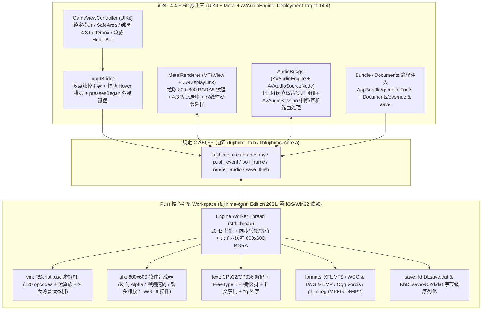

# 《腐姫～euthanasia～》iOS 14.4 原版体验移植技术方案（定稿）

> **状态**：架构与关键技术决策已由用户确认定稿  
> **基准目标（Ground Truth）**：原版日文 DL 版 `game/腐姫ＤＬ/KhimeDL.exe`（SHA-256: `2dfc7b78d32867716ab0406ccbf176b55a76faea1cb9c40feac25c90775222fe`）及原版资源（含 `game/腐姫ＤＬ/补丁/原版备份/` 下的原版 `scr.xfl`、`grpo_tp.xfl`）  
> **本地化兼容**：在 100% 原版日文基准之上，内建**汉化补丁兼容模式**（对应 `KhimeDL_CHS.exe` + `V1.0 汉化补丁` 的 `scr.xfl`、`grpo_tp.xfl` 及散落目录 `grpe/`、`grpo_ex/`、`grps/`）  
> **目标运行平台**：iOS 14.4+（`arm64` 真机）  
> **核心技术栈**：**Rust 核心引擎 (`fujihime-core`) + Swift（UIKit + Metal + AVAudioEngine）iOS 14.4 薄壳**  
> **调研环境**：Docker 隔离容器 `fujihime-re`（Ghidra 12.1.4 + `rea-agents@6.7.0` + 原始资源字节级解析）

---

## 1. 已确认的核心技术决策总览

| 决策维度 | 最终定案 | 关键工程约束 |
| :--- | :--- | :--- |
| **1. 核心技术栈** | **Rust (`fujihime-core`) + Swift（UIKit + Metal + AVAudioEngine）** | Rust 编译为 `staticlib` (`libfujihime_core.a`, `aarch64-apple-ios`)，通过极薄的 C ABI 头文件与 Swift 桥接；零 UIKit/Win32 依赖，可在 Linux Docker & GitHub Actions `ubuntu-latest` 直接跑全套 `cargo test` 无头回归 |
| **2. 原版与汉化模式** | **原版日文（CP932）为 Ground Truth + 内建汉化兼容模式（CP936/GBK）** | 支持外部散落目录优先覆盖 `.xfl`、`grpo_tp.xfl` 中 `.bmp` 图像解码、`KhimeDL_CHS.exe` 的 36 处差异（字符集切换、字体切换、25 条中文弹窗文案），通过运行时配置切换 |
| **3. 字体方案** | **核心内置 FreeType 2 静态库 + 字体随 App Bundle 打包进 IPA** | 字体存放于 `AppBundle/Fonts/`（支持打入原版 `msgothic.ttc` / `msmincho.ttc` 与汉化黑体，并提供开源等宽中日文字体兜底；缺失原版字体时明确提示，绝不静默降级）。统一由 FreeType 2 渲染 1-bit / 65 级灰度、`@` 竖排 90° 旋转与日文禁则 |
| **4. MPEG-1 视频播放** | **Rust `cc` crate 静态集成纯 C `pl_mpeg`（MIT）零转码软解** | 直接读取原版 `mov/0001.mpg` 与 `mov/0002.mpg`（MPEG-1 Video + MP2 Audio），零修改原始资产；Phase 1A 优先跑全量 3,346 帧解码校验，若发现码流不兼容则自动回退至裁剪版 FFmpeg |
| **5. 4:3 全面屏黑边** | **两侧黑边保持纯黑（零虚拟按钮）** | 严格居中 4:3（800:600）原版画面；全部操作依靠原版画面内 `compane` 浮动面板 + 无侵入多点触控手势 + 外接硬件键盘透传 |
| **6. 资产与 CI 打包** | **版权游戏资产绝不进 Git；GitHub Actions 构建 IPA 时按需注入打进 App Bundle** | Git 仅保留源码与工程配置；CI 打包流程支持从外部 Secret/Release 源拉取游戏资产注入 `AppBundle/game/`，同时运行时支持 `Documents/override/` 热覆盖与 `Documents/save/` 持久化存档（与 PC 原版 `KhDLsave.dat` 字节级互通） |

---

## 2. 原版引擎与资产实证盘点（Ground Truth）

### 2.1 可执行文件与 PE32 结构画像

| 项目 | 实测值 | 实证来源 |
| :--- | :--- | :--- |
| 文件大小 / 架构 | 466,944 字节 / PE32 (`x86`, ImageBase `0x00400000`) | `khimedl-ghidra-overview.json` (`ev_eed0661d...`) |
| 节表布局 | `.text` (`0x401000`, 401 KB)、`.rdata` (`0x463000`, 40 KB)、`.data` (`0x46d000`, 226 KB 虚拟 / 16 KB 物理)、`.rsrc` (`0x4a5000`, 4 KB) | PE Section Header 字节解析 |
| 函数 / 字符串规模 | 2,725 个识别过程、481 个 Ghidra 定义字符串 | `ev_eed0661d...` |
| 静态 PE 资源 | 共 5 项（日语 LCID `1041`：图标 `32×32`、版本信息等，无对话框/菜单模板依赖） | REA `inspect_pe_resources` (`ev_ed045346...`) |
| 导入 DLL（共 7 个，无延迟导入） | `KERNEL32.dll` (86)、`USER32.dll` (50)、`GDI32.dll` (21)、`MSACM32.dll` (13)、`WINMM.dll` (7)、`IMM32.dll` (3)、`ole32.dll` (3)；**无 DirectDraw/Direct3D、无 `ADVAPI32`（零注册表）** | PE Import Directory 精确解析 |
| COM GUID 实测 | `CLSID_DirectSound` (`0x467eec`)、`IID_IDirectSound` (`0x467edc`)；未检出 DirectDraw / DirectShow / DirectInput / DirectMusic | `.rdata` GUID 扫描 + `FUN_00459750` |
| 引擎标识与内置配置 | `RScript.exe` (`0x46c890`)、`LiosGameClass` (`0x46e1a0`)、`APINI` 配置块 (`0x46d758`)：标题 `腐り姫ＤＬ`、分辨率 **`800×600`** (`0x46d758+0x154/0x158`)、存档前缀 `KhDLsave` | `FUN_0041d010` (`ev_9e0ebac9...`) + `.data` 实测 |
| 原版 vs 汉化版 EXE 差异 | 仅 **36 处、共 470 字节** 差异：11 处 `0x80` (`SHIFTJIS_CHARSET`) → `0x86` (`GB2312_CHARSET`)，25 处为字体名（`ＭＳ ゴシック`/`ＭＳ 明朝` → `黑体`）与确认弹窗文案 | `KhimeDL.exe` vs `KhimeDL_CHS.exe` 字节 diff |

### 2.2 全量游戏资产实证

原版资源总体积约 **895 MB**（含 `mov/`）；汉化补丁在根目录替换了 `scr.xfl`、`grpo_tp.xfl` 并附加散落覆盖目录 `grpe/` (10 files)、`grpo_ex/` (210 files)、`grps/` (14 files)：

| 资产文件（原版基准） | 体积 | 条目数 | 内部格式与实测特征 |
| :--- | ---: | ---: | :--- |
| `bgm.xfl` | 104.9 MB | 21 | 全部 `.wav`：`wFormatTag=0x6771`, 44100 Hz, 2ch, 16-bit，`data` 首字节 `OggS`；chunk 为 `fmt / fact / data` |
| `voice.xfl` | 240.9 MB | 3,015 | 全部 `.wav`：`wFormatTag=0x6771`, 44100 Hz, 1ch, 16-bit，`data` 首字节 `OggS`；含 `LIST` 元数据 |
| `wav.xfl` | 17.4 MB | 48 | 全部 `.wav`：`wFormatTag=0x6771`, 44100 Hz, 1ch, 16-bit，`data` 首字节 `OggS`（音效 SE） |
| `grpe.xfl` | 300.9 MB | 329 | 全部 `.wcg`（`WGq\x02`, 32bpp, `0x4000`），均为 `800×600` 事件 CG |
| `grpo.xfl` | 71.9 MB | 669 | 全部 `.wcg`（主流 `800×600` 背景 653 张 + 小图部件） |
| `grpp.xfl` | 74.0 MB | 198 | 全部 `.wcg`，全部为 **`800×700`** |
| `grps.xfl` | 39.9 MB | 82 | **55 个 `.wcg`**（含外字 `gf001~gf010, gf999.wcg`）+ **15 个 `.lwg`**（UI 图层包 `LG\x01\x00`）+ **12 个 `.msk`**（`ef14~ef19, ef21~ef26.msk`，均为 `800×600` 24bpp BMP 转场规则图） |
| `grpf.xfl` | 3.3 MB | 40 | 全部 `.wcg`（`241×327`） |
| `grpo_ex.xfl` | 9.2 MB | 320 | 全部 `.wcg`（鉴赏缩略图/UI 部件） |
| `补丁/原版备份/grpo_tp.xfl` | 4.9 MB | 116 | 原版全部 `.wcg`（汉化版根目录 `grpo_tp.xfl` 将其中 36 个替换为 `.bmp`） |
| `补丁/原版备份/scr.xfl` | 2.1 MB | 341 | 全部 `.gsc` 编译脚本，共含 **18,820 条非空 Shift_JIS 文本**（汉化版 `scr.xfl` 同样 341 个 `.gsc`，文本为 GBK） |
| `mov/0001.mpg` | 47.4 MB | 1 | MPEG-1 PS：视频 `320×240` @ 30fps（~3,215 帧 ≈ 107.2s），音频 MP2 44100 Hz 立体声 |
| `mov/0002.mpg` | 278 KB | 1 | MPEG-1 PS：视频 `640×480` @ 30fps（~131 帧 ≈ 4.4s），音频 MP2 44100 Hz 立体声 |
| `vorbis.acm` | 1.3 MB | 1 | Win32 ACM 驱动（Xiphophorus 2001），iOS 端由原生 Vorbis 解码替代 |

### 2.3 已实证的内部子系统机制

1. **`.xfl` 封包与虚拟文件系统（`FUN_00431e60`, `ev_d1ad6cf9...`）**
   - 文件头 12 字节：`magic[4] = "LB\x01\x00"` + `u32 dir_size` + `u32 entry_count`；每项 40 字节：`name[32]` + `u32 offset`（相对 `12 + dir_size`）+ `u32 length`，无加密无压缩。
   - 查找顺序：**外部散落目录优先覆盖 → 对应 `.xfl` 封包回退**；并同时支持 `.wcg` / `.bmp` / `.lwg` / `.msk`（兼容汉化版 `grpo_tp.xfl` 内 36 张 `.bmp` 与 `grpe/`、`grpo_ex/`、`grps/` 散落覆盖）。

2. **图像与软件合成器（`0x450b20`, `0x42f3b0`/`0x42f450`, `0x42b640`/`0x42b6e0`, `0x445fc0`）**
   - 帧缓冲为 `800×600` 32-bit Top-Down BGRA（`CreateDIBSection`, `biHeight = -600`）。
   - **反向 Alpha 约定**：引擎内部像素为 **`0x00` = 完全不透明、`0xFF` = 完全透明**（已由 `FUN_0044f1b0` / `FUN_0044fca0` 实证）。
   - `.lwg`（`LG\x01\x00`）：头部 24 字节（`magic, height, width, count, flags, idx_sz`）+ 变长命名目录（`x, y, flag, off, len, nlen, name`）+ 4 字节总数据长 + 内嵌 `.wcg` 数据段。

3. **文字排版、字体与外字渲染（`0x441b00`, `0x44f1b0`..`0x450190`, `0x415380`）**
   - 双字体：原版 `ＭＳ ゴシック` (`0x46d110`) 与 `ＭＳ 明朝` (`0x46e194`)；汉化版映射为黑体。
   - 同时支持**横排与竖排**（`"@"` 前缀竖排字体 + `MAT2` 90° 旋转矩阵），以及 **1-bit (`GGO_BITMAP=1`)** 与 **65 级灰度抗锯齿 (`GGO_GRAY8_BITMAP=6`)** 两条字形光栅化路径。
   - 内置 Shift_JIS 行首/行尾禁则字符表（`FUN_00441b00`）。
   - 全量实测 6 类 `^` 控制码：`^n` (3,610)、`^g001..010/999` 内联外字图元 `gf%03d.wcg` (682)、`^cw/^cr/^cg` 颜色 (224)、`^fm` 切字体 (127)、`^m` (57)、`^d0/^d3/^d5` 延迟 (18)。

4. **脚本虚拟机与 9 大顶层场景（`0x41d010`, `0x417c70`, `0x41f9f0`）**
   - `.gsc` 头部 36 字节（9×`u32`）；`FUN_0041f9f0`（843 行）分发运算指令族（`0x1000..0xF000`）+ 精确 **120 个命令 opcode**（`0x03..0xD5`）。
   - 顶层 9 个注册场景（`FUN_004466e0`）：标题 (`0x4264d0`)、主游戏 (`0x419800`)、Extra (`0x41cdb0`)、CG 鉴赏 (`0x41bb50`)、场景回想 (`0x425410`)、音乐鉴赏 (`0x41e590`) 及 3 个子界面 (`0x4182b0`, `0x419210`, `0x418530`)。

5. **音频、视频、转场与存档（`0x459750`, `0x448d90`, `0x450720`, `0x422060`, `0x41dcd0..0x41e0d0`, `0x427490`）**
   - 音频：双槽位 BGM（无缝 Crossfade、无限循环/单次播放）+ Voice（带 `param_4 * 50ms` 延迟）+ 双 SE 轨，全部解码 RIFF-Vorbis (`0x6771`) 44.1kHz PCM。
   - 视频：原版 MCI `mpegvideo` 拉伸至 `800×600` 播放，播完发 `WM_USER+0x1E` (`0x41e`) 唤醒脚本线程。
   - 转场：特效 `0` 瞬切、`1..4` 内置渐变、`14..19/21..26` 规则掩码 `ef%02d.msk`、`100..299` 镜头 Zoom-In/Out。
   - 存档：`KhDLsave.dat`（206,024B = 系统配置 `0x814` + 全局变量 `6,000B` + 两份已读位图）与 `KhDLsave%02d.dat`（75,026B = `42B` 头 + 主状态 `0x5bc4` + 局部变量 `14,000B` + 回滚状态 `0x5bc4` + 辅助变量 `14,000B`），可与 PC 原版存档 100% 字节级互通。

---

## 3. 架构设计：Rust 核心引擎 + Swift iOS 14.4 薄壳

### 3.1 系统分层与双线程同构模型

原版 `KhimeDL.exe` 本身即采用**双线程架构**（UI 消息主线程 `0x447320` + 阻塞式脚本/转场工作线程 `0x41f9f0`）。移植到 iOS 14.4 时保持完全同构，避免在 UIKit 主线程阻塞 `CADisplayLink` 或被 Watchdog 终止：



### 3.2 Rust Workspace 与第三方依赖选型（严格面向 `aarch64-apple-ios` 静态零痛点编译）

| 模块 / 能力 | 推荐 Crate / 原生 C 库 | 选择理由（针对 iOS 14.4 & GitHub Actions） |
| :--- | :--- | :--- |
| 字符编码（Shift_JIS / GBK） | `encoding_rs`（Mozilla 纯 Rust） | 工业级 WHATWG CP932/GBK 表，无系统依赖，补充原版 CP932 特殊扩展位精确对照 |
| 图像解码（`.wcg`, `.lwg`, `.msk`/`.bmp`） | 自研纯 Rust（零外部重型图像库） | `.wcg` / `.lwg` 为引擎私有格式；`.msk` / `.bmp` 仅需标准 BMP 头解析，纯 Rust 零 unsafe |
| Ogg Vorbis 音频解码 | `lewton`（纯 Rust）**或** `ogg` + `vorbis` (`libvorbis` 静态 C) | 优先用纯 Rust `lewton`（零 C 交叉编译复杂度，先在容器对全部 3,084 个音频做全量零错解码基准测试；若个别码流或 CPU 占用不理想，无缝切 `libvorbis` C 静态库） |
| MPEG-1 + MP2 视频解码 | **`pl_mpeg`**（单头文件纯 C, MIT），通过 Rust `cc` crate 静态编入 | 仅 1 个头文件，在 `aarch64-apple-ios` 上零交叉编译折腾；Phase 1A 立即对 `0001.mpg` / `0002.mpg` 全量 3,346 帧验证，异常则切裁剪版 FFmpeg |
| 字体光栅化（1-bit + 65 级灰度 + 竖排） | **FreeType 2**（源码 vendored 或 `freetype-sys` 静态编译进 `libfujihime_core.a`） | 精准支持 `.ttc` 字体集、1-bit mono、65 级灰度量化以及 `GSUB` `vert` / 90° 旋转竖排，保证 Linux 回归测试与 iOS 14.4 真机逐像素一致 |
| C FFI 绑定生成 | `cbindgen` 自动生成 `include/fujihime_ffi.h` | Swift 通过 Bridging Header 直接安全调用，ABI 清晰无手写同步漂移 |

### 3.3 极简 C ABI FFI 契约草案（Rust ↔ Swift）

- **生命周期**：
  - `fujihime_create(const FujihimeConfig* cfg) -> FujihimeHandle*`（传入 `bundle_game_dir`、`bundle_fonts_dir`、`override_dir`、`save_dir`、`locale_mode` (`JP_ORIG` / `ZH_CHS`)）
  - `fujihime_destroy(FujihimeHandle*)`
  - `fujihime_set_paused(FujihimeHandle*, bool paused)`（iOS 切后台暂停引擎与自动刷新 `KhDLsave.dat`）
- **帧交换（无锁双缓冲）**：
  - `fujihime_poll_frame(FujihimeHandle*, const uint8_t** out_bgra8, uint32_t* out_w, uint32_t* out_h, uint64_t* out_gen) -> bool`（若帧版本号递增则返回 `true`，Metal 直接 `replaceRegion` 上传至 `MTLPixelFormatBGRA8Unorm`，片段着色器输出 `float4(rgb, 1.0)` 忽略反向 alpha 字节）
- **音频拉取（CoreAudio / `AVAudioSourceNode` 实时回调线程安全）**：
  - `fujihime_render_audio(FujihimeHandle*, float* interleaved_stereo_out, uint32_t frame_count)`（44,100 Hz，无堆分配、无互斥锁阻塞，使用 SPSC RingBuffer 从解码线程喂数）
- **输入事件注入（UIKit 主线程 → 引擎事件队列）**：
  - `fujihime_push_pointer(FujihimeHandle*, uint8_t kind, int32_t x_800, int32_t y_600)`（`Move / Down / Up / RightClick / MiddleClick / WheelUp / WheelDown`）
  - `fujihime_push_key(FujihimeHandle*, uint16_t vk_code, bool is_down)`（直接复用原版 Win32 `VK_*` 键码：`Enter/Space/Ctrl/Shift/Tab/Esc/Up/Down/F1`）

### 3.4 iOS 14.4 纯黑 Letterbox 与触控/键盘映射细则

1. **视觉呈现**：强制横屏、4:3 居中、`MTKView` 清除色纯黑 (`#000000`)、**两侧黑边完全保持纯黑，零叠加任何额外虚拟按钮**；启用 `prefersHomeIndicatorAutoHidden = YES` 与 `prefersStatusBarHidden = YES`。
2. **模拟悬停（Hover）与防误触点击**：
   - `touchesBegan` & `touchesMoved`（单指落于 800×600 画面内）：实时将逻辑坐标作为 `Pointer::Move` 投入引擎，触发原版按钮 `_f` 高亮与 `compane` 面板唤出；
   - `touchesEnded`：在无拖动取消且未触发长按/滑动手势时投递 `Pointer::Up`（等效原版 `WM_LBUTTONUP`）。
3. **多点触控手势（零侵入原版画面，100% 映射 PC 快捷键）**：
   - **单指轻点**：左键点击（推进文本 / 确认选项 / 点击原版 UI）
   - **双指轻点**：右键 / `Esc`（打开/关闭菜单、退出存档/设置/CG 界面）
   - **单指垂直滑动（上滑 / 下滑）**：滚轮上下（唤出并翻阅 Backlog 历史文本）
   - **单指长按（≥ 0.45s）**：按下 `VK_CONTROL` 快进，松手立即发送 `VK_CONTROL` 抬起停止快进
   - **三指轻点**：`VK_SHIFT`（隐藏/恢复文本框纯享 CG）
4. **外接硬件键盘**：通过 iOS 14.4 原生 `UIResponder.pressesBegan` / `pressesEnded` 直接透传全部原版键位。
5. **音频与电源生命周期**：监听 `AVAudioSessionInterruptionNotification`、`AVAudioSessionRouteChangeNotification`、`UIApplicationWillResignActiveNotification`；自动模式与视频播放期间管理 `UIApplication.shared.isIdleTimerDisabled`。

### 3.5 资产注入与 GitHub Actions 工程布局

```text
src/
├── Cargo.toml                     # Rust Workspace
├── fujihime-core/                 # 纯引擎核心库 (rlib + staticlib)
│   ├── build.rs                   # cc 编译 pl_mpeg / FreeType + cbindgen 生成头文件
│   ├── src/
│   │   ├── archive/               # XFL VFS + 外部散落覆盖 + 汉化双模式路由
│   │   ├── formats/               # WCG / LWG / BMP(MSK) / GSC 解析
│   │   ├── vm/                    # RScript VM (120 opcodes + 运算族) + 9 大顶层场景
│   │   ├── gfx/                   # 800x600 BGRA 软件合成器 / 反向 Alpha / 转场 / LWG 控件
│   │   ├── text/                  # CP932 & CP936 / FreeType 2 / 横竖排 / 禁则 / ^g 外字
│   │   ├── audio/                 # RIFF-Vorbis 解码 + 44.1kHz 无锁多轨混音
│   │   ├── video/                 # pl_mpeg FFI 封装 (MPEG-1 + MP2)
│   │   ├── save/                  # KhDLsave.dat & KhDLsave%02d.dat 读写
│   │   └── ffi.rs                 # C ABI 导出
│   └── tests/                     # Headless 自动化回归测试 (Linux 容器 & CI)
├── third_party/                   # pl_mpeg.h + FreeType 源码（或锁定版本子模块）
└── ios/                           # Swift iOS 14.4 宿主工程
    ├── project.yml                # XcodeGen 声明：IPHONEOS_DEPLOYMENT_TARGET=14.4, ARCHS=arm64
    ├── Fujihime/
    │   ├── AppDelegate.swift / SceneDelegate.swift
    │   ├── GameViewController.swift
    │   ├── MetalRenderer.swift & Shaders.metal
    │   ├── AudioBridge.swift
    │   ├── InputBridge.swift
    │   ├── BridgingHeader.h
    │   └── Resources/             # Fonts/（打包字体）& game/（CI 构建期注入，.gitignore 忽略）
    └── scripts/
        └── build-rust-ios.sh      # cargo build --release --target aarch64-apple-ios
```

- **资产查找优先级（运行时）**：
  1. `Documents/override/`（最高优先，支持用户真机侧随时替换补丁/字体）
  2. `AppBundle/game/`（GitHub Actions 打包 IPA 时从外部加密资产包注入打入，开箱即玩）
  3. `Documents/game/`（备用，支持无内置资产的瘦身构建版从「文件」App 导入）
- **字体打包与查找**：CI/构建时将字体放入 `AppBundle/Fonts/`（`msgothic.ttc` / `msmincho.ttc` / 汉化黑体，或开源兜底字体），运行时同样支持 `Documents/Fonts/` 覆盖；始终向日志/设置界面明确报告当前生效字体文件。
- **GitHub Actions 双 Job 规划**（后续 Phase 4 落地）：
  - `core-test` (`ubuntu-latest`)：运行 `cargo test --workspace` + 格式/VM/存档/渲染单元测试；
  - `ios-build` (`macos-14`/`macos-15`)：安装 `aarch64-apple-ios` target → 编译 `libfujihime_core.a` → 若配置了资产注入 Secret 则拉取并解压游戏资产与字体至 `Resources/game/` 和 `Resources/Fonts/` → `xcodegen generate` → `xcodebuild -sdk iphoneos -arch arm64 IPHONEOS_DEPLOYMENT_TARGET=14.4 CODE_SIGNING_ALLOWED=NO` 生成未签名 `.app`（后续打包 IPA 由工作流按需接管）。

---

## 4. 待逆向清零的未知项清单（Phase 1 任务包）

严格遵循 `AGENTS.md`「严禁瞎编、有据可依」原则，Phase 1 将所有 `UNKNOWN` 拆分为 **3 个串行高内聚子包**（每次仅派 1 个子 Agent 深度攻坚并验收，确保 100% 实证清零）：

### Phase 1A：图像 / 图层混合 / 转场 / 视频全量实证
- **`UNK-01`**：反编译 `.wcg` (`WGq\x02`) 完整解压算法（定位 `0x42f450` 之后的解码虚函数，验证双通道/码表/游程或霍夫曼细节）；在容器内写只读 Python 验证脚本，对全部 **1,727 张原版 `.wcg`**、**15 个 `.lwg`**、**12 张 `.msk`** 以及汉化版 `grpo_tp.xfl` 36 张 `.bmp` 跑 **100% 全量无错解码验收**（并导出若干样例图核验尺寸与校验和）。
- **`UNK-03`**：反编译软件图层混合器（`0x435700`..`0x4359e0` 族），列出全部混合模式编号、反向 Alpha 混合公式、滤镜（黑白/反色/变暗等）与遮罩阈值公式。
- **`UNK-04`**：反编译转场 3/4（`0x448a30`, `0x448b50`, `0x4487c0`, `0x4488e0`），与转场 1/2/掩码/缩放汇总成完整转场规格表。
- **`UNK-10`**：反编译 `0x449060` 与 `0x4506f0..0x4508a0` 确认 `.mpg` 播放控制（跳过键、音量/静音影响）；并在容器内使用纯 C `pl_mpeg` 对 `mov/0001.mpg` 与 `mov/0002.mpg` 执行**全量帧与音轨解码验证**，给出实测通过/异常结论。
- **交付文档**：`docs/formats-and-gfx-spec.md` + `re/evidence/` 关键反编译证据摘要。

### Phase 1B：`.gsc` 脚本格式与 120 个 VM Opcode 全量规格化
- **`UNK-02`**：完整反编译 `FUN_0041f9f0` 及其所有子处理函数，建立 `0x1000..0xF000` 运算指令族 + **120 个命令 opcode (`0x03..0xD5`)** 的逐条参数签名、栈/变量语义、副作用完整规格表。
- **`UNK-06`**：扫描全部 341 个原版 `.gsc`（及汉化版 341 个 `.gsc`），验证是否存在 0 个未知 opcode、0 字节解析残余，并核实 `RICHED32` (`WM_USER+0x32` / `0x403210`) 是否被任意脚本实际触发。
- **交付文档**：`docs/vm-opcodes-spec.md` + 容器内全量 341 脚本反汇编校验报告。

### Phase 1C：文本排版 / 字体 / 音频音量 / 存档 / 9 大场景规格化
- **`UNK-05`**：反编译 `FUN_00416f60`、`FUN_00421310`、`0x44f1b0..0x450190`，确认字号表、行距/字距、描边/阴影偏移、RGB 色值（`^cw/^cr/^cg`）、`^m`/`^d` 语义及完整禁则字符表。
- **`UNK-07`**：反编译 `VK_F1` (`0x41e490`) 与 9 个顶层场景入口（`0x4264d0`, `0x419800`, `0x41cdb0`, `0x4182b0`, `0x41bb50`, `0x425410`, `0x41e590`, `0x419210`, `0x418530`）确认职责与状态流转。
- **`UNK-08`**：完整映射 `DAT_00471378` (2,068B 系统配置) 与 `DAT_00477750` (23,492B 槽位快照) 字段偏移，对全 CG 档 `KhDLsave.dat` 跑字节级往返解析验证。
- **`UNK-09`**：反编译 `0x448d00`、`0x448fd0` 及 DirectSound 音量设置，确认音量曲线与淡入淡出时长公式；并在容器内校验全量 3,084 个 Ogg Vorbis 音频流头一致性。
- **交付文档**：`docs/text-audio-save-ui-spec.md`。

---

## 5. 全项目分阶段里程碑

| 阶段 | 核心内容 | 完成判据（Definition of Done） |
| :--- | :--- | :--- |
| **Phase 1 (1A → 1B → 1C)** | 逆向规格 100% 清零 | 3 份规格文档完备；1,727 `.wcg` / 15 `.lwg` / 341 `.gsc` / 3,084 `.wav` / 2 `.mpg` / `KhDLsave.dat` 全量解析验收通过 |
| **Phase 2：Rust 核心引擎** | 在 Docker 容器内新增 Rust 工具链，完成 `fujihime-core` 全部子系统 | `cargo test` 全绿；Headless 模式可跑通标题 → OP → 第一章 → 分支 → 存档/读档 → 转场，输出 PNG 帧与 WAV 音频对拍无误 |
| **Phase 3：9 大界面与汉化模式** | 1:1 复原全部内置 UI（Title/主游戏/`compane`/`confscrn`/`savescrn`/`selmap`/CG/回想/音乐/Extra）及原版/汉化双模式 | 导入全 CG 档 `KhDLsave.dat` 解锁状态 100% 吻合；原版日文与汉化版均可流畅通关、无乱码/越界 |
| **Phase 4：Swift iOS 14.4 壳 + GitHub Actions** | UIKit + Metal + AVAudioEngine + 手势/键盘 + `project.yml` + Actions 工作流（含构建期资产与字体注入钩子） | `ubuntu-latest` Rust 测试全绿；`macos` Runner 编译出 `iOS 14.4 arm64` 无签名 `.app` 零报错 |
| **Phase 5：真机联调与最终打磨** | iOS 14.4 真机端到端验收（帧率、触控、音画同步、后台恢复、PC↔iOS 存档互通） | 零崩溃、零泄漏、与原版体验 1:1 一致 |

---

## 附录：初始调研 REA / Ghidra 实证索引

| 证据标识 / 虚地址 | 核查内容 |
| :--- | :--- |
| `re/evidence/khimedl-ghidra-overview.json` (`ev_eed0661d...`) | `KhimeDL.exe` PE32 段表、2,725 过程、481 字符串总览 |
| `REA inspect_pe_resources` (`ev_ed045346...`) | 完整 PE32 资源树（5 项资源，日语 LCID 1041） |
| `FUN_0041d010` (`ev_9e0ebac9...`) | 主初始化：`vorbis.acm` 加载、`APINI`（800×600）、9 大顶层场景注册 |
| `FUN_00450b20` / `0x445fc0` / `0x446440` / `0x446590` | 32-bit Top-Down BGRA DIBSection、`BitBlt` 上屏、`StretchBlt` 镜头缩放 |
| `FUN_00459750` + `0x467eec`/`0x467edc` | COM `IDirectSound` 初始化 |
| `FUN_00448d90` / `0x448e60` (`ev_2b5c6977...`) | 双槽位 BGM 交叉淡入淡出、循环与单次播放 |
| `FUN_00450720` / `0x450820` (`ev_1e6c074c...`) | MCI `mpegvideo` 拉伸全窗口视频播放与 `WM_USER+0x1E` 事件 |
| `FUN_00431e60` (`ev_d1ad6cf9...`) | `.xfl` 封包与路径解析 |
| `FUN_0042f3b0` / `0x42f450` (`ev_f22e3865...`) | `.wcg` (`WGq\x02`) 头部解析与 32-bit Top-Down 输出设置 |
| `FUN_0042b640` / `0x42b6e0` (`ev_cc09b425...`) | `.lwg` (`LG\x01\x00`) UI 图层容器解析 |
| `FUN_0044f1b0`..`0x44fca0` / `0x441b00` | `GetGlyphOutlineA`（1-bit & 65 级灰度）、`@` 竖排、反向 Alpha、Shift_JIS 禁则表 |
| `FUN_00417c70` / `FUN_0041f9f0` (`ev_291f2a1d...`) | `.gsc` 36 字节头与 120 命令 Opcode + 运算指令族分发器 |
| `FUN_00422060` / `0x4483f0` / `0x4482c0` / `0x448170` / `0x448540` / `0x4486c0` | 转场特效分发（淡变、`ef%02d.msk` 规则掩码、镜头缩放） |
| `FUN_0041dcd0`..`0x41e0d0` / `0x427490` | `KhDLsave.dat` 与 `KhDLsave%02d.dat` 布局与已读位图序列化 |
| `FUN_00447320` / `0x447a90` / `0x447b30` / `0x41a2a0` (`ev_d629b348...`) | 主消息循环、20Hz/500ms 定时器与全量键鼠输入映射 |
